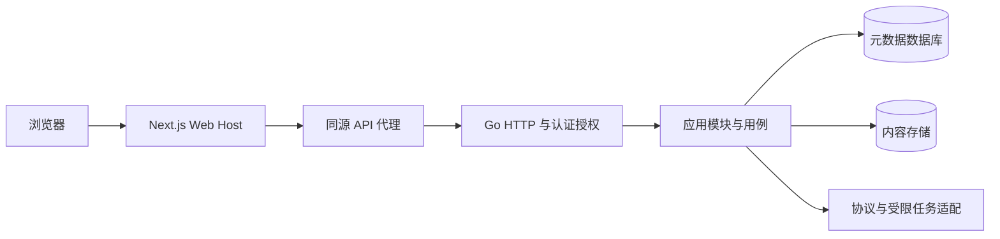

# 架构说明

CloudDrive 围绕文件的保存、组织、获取与协作运行。账户、权限和管理能力服务于同一套文件与身份事实；浏览器体验、协议适配和内容存储各有明确的所有者。当前范围与尚未验证的能力见[项目范围](../repository-scope.md)，用户行为见[文件管理](../operations/file-management.md)。

## 当前运行结构

Web 与 Go 是两个独立进程。Web Host 拥有路由、浏览器资源和交互装配；Go 拥有会话、权限、业务事务、持久任务和存储。Next standalone 构建不绑定 Go 地址，运行时代理复用既有 API，不保存另一份认证或业务状态。部署、地址和代理限制以[部署说明](../operations/clouddrive-deployment.md)为准。

`cmd/app` 只处理进程入口；`internal/composition` 显式连接底层能力和业务模块。模块通过 typed contribution 交给应用组合根，资源由 Kernel 装配与租约管理。业务用例依赖消费方需要的窄接口，不接收万能容器，也不通过包扫描或全局注册寻找依赖。

## 状态与资源由谁拥有

| 范围         | 所有者                                    | 边界                                                                   |
| ------------ | ----------------------------------------- | ---------------------------------------------------------------------- |
| 静态声明     | 启动期 `applicationBlueprint`             | 冻结 HTTP 定义、权限目录、操作策略与 WebUI 目录，各代及 CLI 共享。     |
| 服务运行态   | Application Generation                    | 同一配置快照构造资源与运行模块；候选失败保持当前代，提交后旧代排空。   |
| 监听器与进程 | ListenerHub 与进程入口                    | listener 不随对象图重建而先关后开；停止与清理有明确等待边界。          |
| 文件与协作   | files 用例及仓储                          | 目录、归属、配额、分享、版本、写锁与发布状态在相应事务内判断。         |
| 内容字节     | Storage 租约                              | 数据库事实与不可变内容对象分别持久化，发布意图和补偿处理跨资源失败。   |
| 浏览器传输   | 账号所属的 FilesRuntime / TransferRuntime | 应用内导航保持同一队列；账号变化或卸载取消请求并释放资源。             |
| 阅读与编辑   | 每次打开的阅读会话与 Host renderer        | 各会话独立拥有取消、Worker、frame 与临时 URL；关闭不取消其它阅读会话。 |

配置节由 composition 集中声明，未知配置在资源副作用前失败。不是所有变化都需要热替换：没有候选构造、准入、排空与回滚语义的能力应明确要求重启。one-shot CLI 使用自己的 invocation 资源，不启动长期 watcher、listener 或 Consumer。

## 一条文件链路如何跨越边界

文件页面在 Surface 表达浏览、编辑或分享意图，Host Port 执行浏览器 I/O；Next 将同源请求交给 Go 的现有认证、CSRF 和 operation 授权链。files 用例复核主体、范围、内容版本与配额，再通过仓储和 Storage 完成操作。公开分享使用单独的公开 Port 和当前分享策略，不复用私有文件授权。

上传由 tus 处理有界的字节接续，files 负责会话、摘要、配额与最终发布；WebDAV 和外部编辑适配也进入同一业务边界。压缩解析由父任务拥有的受限子进程执行，解析器不装配第二个应用。PDF 等浏览器阅读器由 Host 隔离 SDK 与临时资源，Go 继续提供获准的内容。具体取舍见[技术选型](technology-selection.md)。

界面采用 [Material Design 3](../../frontend/docs/ui-visual-calibration.md)。Design Schema 拥有主题，Adapter 拥有控件及交互状态，Surface Foundation 提供页面结构，业务 Surface 组合用户任务，Web Host 负责运行时。页面差异不能演变为第二套组件或状态语言。

## 从问题找到实现

| 要处理的问题         | 当前入口                                                                                                  |
| -------------------- | --------------------------------------------------------------------------------------------------------- |
| 选择、保留或替换技术 | [技术选型与复核](technology-selection.md)                                                                 |
| 新增业务与跨模块能力 | [模块边界](../../internal/module/README.md)、[模块开发](../development/application-module-development.md) |
| 底层资源、租约与重载 | [Kernel 装配](../../internal/kernel/README.md)、[组件开发](../../internal/kernel/app/README.md)           |
| 文件事务与协议       | [files 模块](../../internal/module/files/README.md)                                                       |
| 浏览器界面与资源     | [前端工程](../../frontend/README.md)                                                                      |
| API 与生成契约       | [API 契约](../../api/README.md)                                                                           |
| 运行、部署与故障     | [运维入口](../operations/README.md)                                                                       |

## 当前说明与历史决定

本页说明当前结构，主题手册拥有各自的使用与约束。重要决定及其当时的限制保留在 [ADR](adr/README.md)，原始研究通过明确 Git revision 查阅。历史 ADR 的“已接受”不自动成为今天的技术、版本或验收结论；旧脚手架定位、spec-first 路线和当时的平台验证范围不得覆盖当前实现。

维护架构时先核对调用方和资源所有权，再决定保留、删除或替换。技术版本由依赖清单与锁文件记录，接口规模由生成契约记录，验证范围由实际检查证明；不在架构入口重复维护易失效的计数与完成清单。
